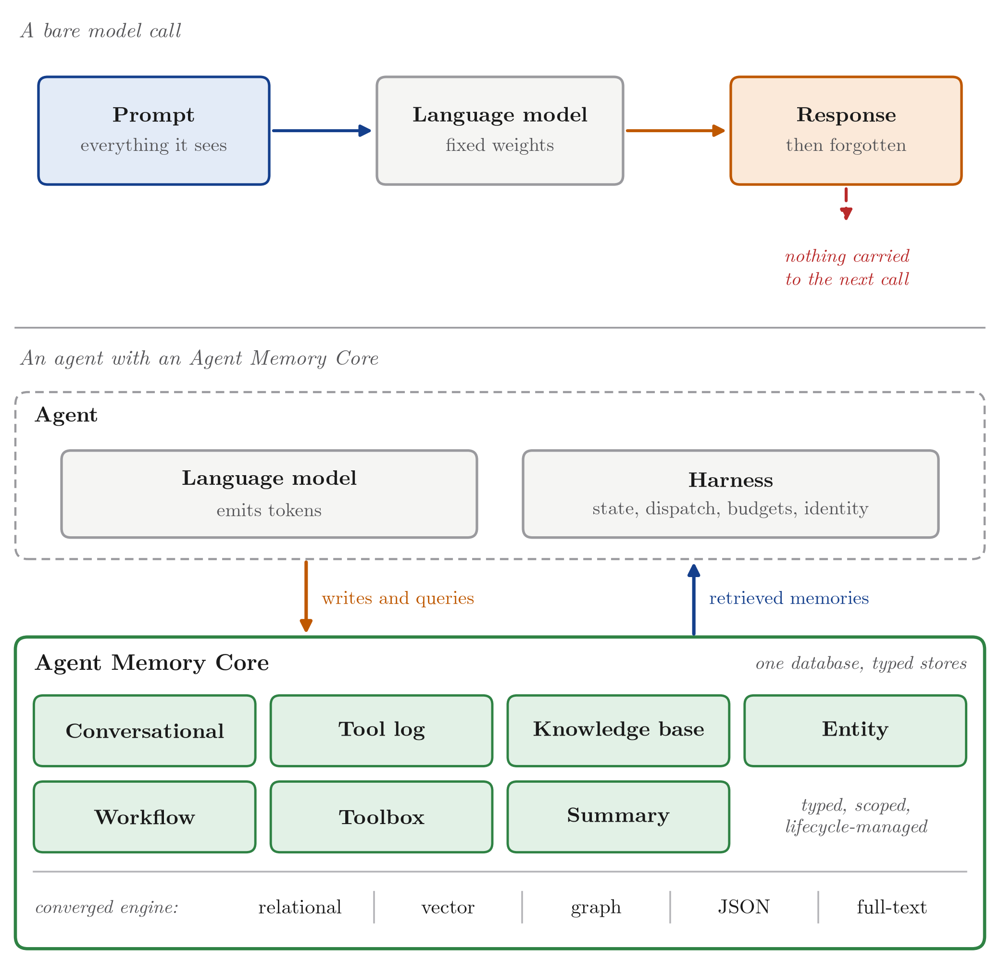
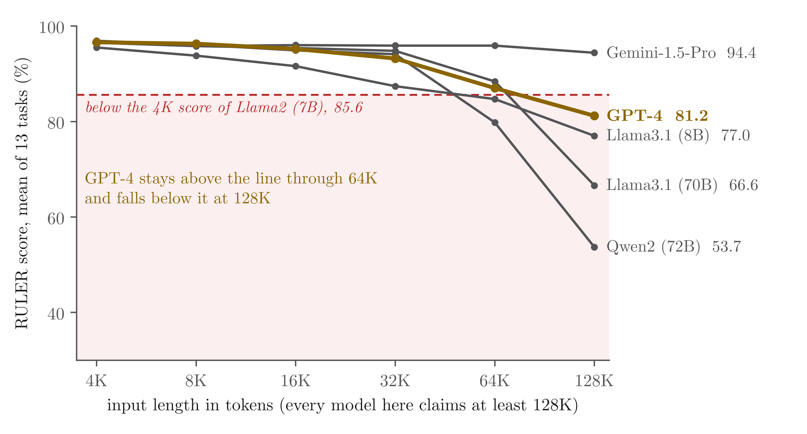
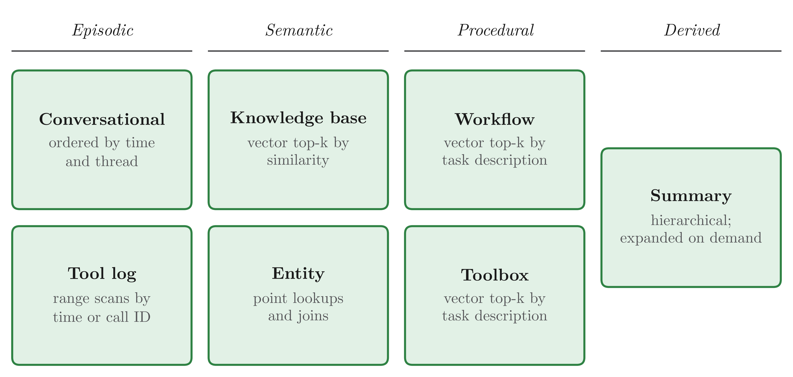
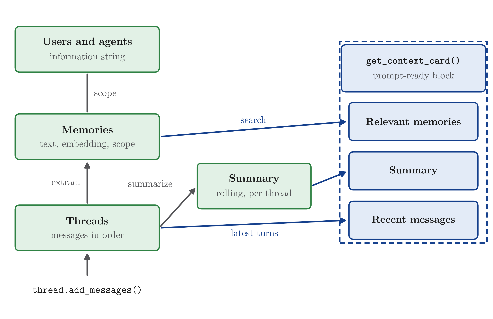
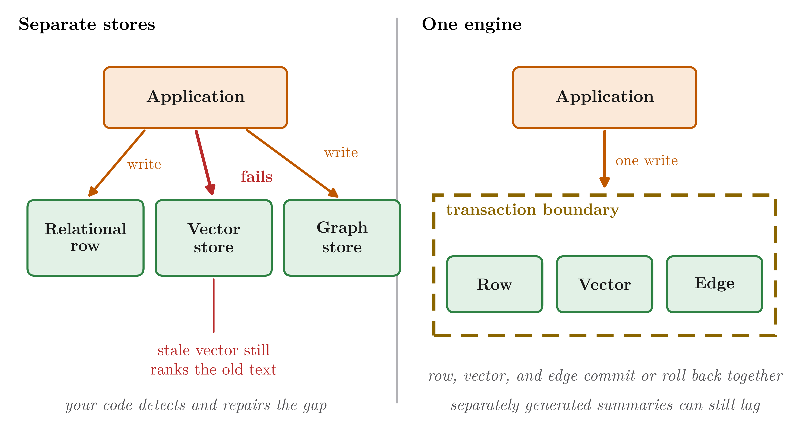
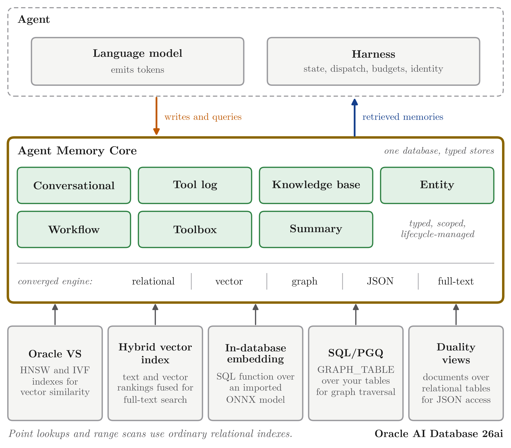
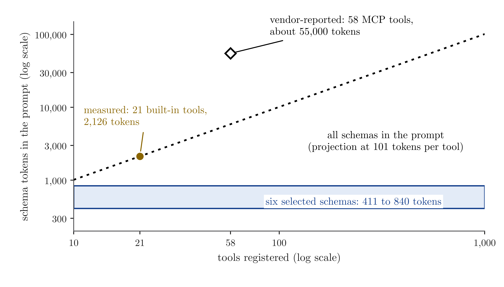
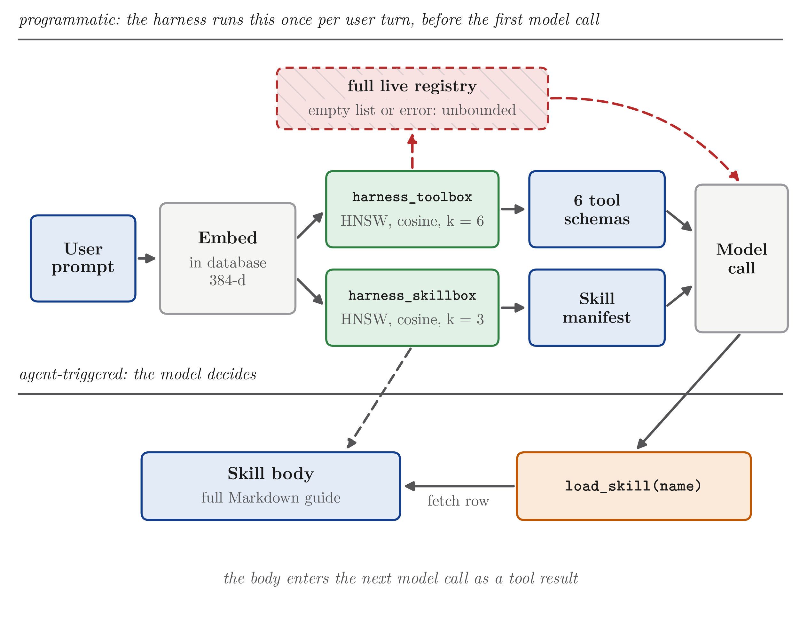

<!-- _class: title -->
<!-- _paginate: false -->
<!-- _footer: "" -->

# Designing and Building Memory for AI Agents

## From stateless to memory-augmented to bootstrapped

**Nacho Martínez Rincón** · AI Engineer & Developer Advocate, Oracle · `@jasperan`

Packt · Agentic Engineering live workshop
Saturday, Nov 21, 2026 · 11:00–15:00 EST · 16:00–20:00 UTC

<!--
11:00. Do not start talking yet: put the repo link in chat first (next slides), then the welcome.
-->

---

# How today works

- **4 hours** = 3h40m of content + two 10-minute breaks
- **Two hands-on labs** (55 min and 35 min) and one mini-lab in Jupyter, then **Lab 3**, the Meridian Bank fraud case, at **workshopwaitingroom.com**
- **Two live polls**, at the end of Modules 1 and 2
- **Checkpoints**: post a screenshot in chat when you reach one
- **Questions**: chat, any time; formal Q&A in the last 10 minutes
- **Certificate**: attend 80%+ and submit the completed Lab 2 run

<!--
Chat etiquette: questions in chat, one thread per problem, setup problems tagged "SETUP".
-->

---

# The plan for the day

| EST | Block | Format |
|---|---|---|
| 11:00–11:15 | Welcome + live environment setup | logistics |
| 11:15–11:45 | Module 1: Why AI Agents Need Memory | concept + live demo |
| 11:45–12:25 | Module 2: Designing an Agent Memory Architecture | concept |
| 12:25–12:35 | **Break 1 + setup checkpoint** | 10 min |
| 12:35–13:30 | Module 3: Build a Memory-Augmented Agent | **Lab 1** |
| 13:30–14:05 | Module 4: Keep Context Bounded (skillbox / toolbox) | concept + mini-lab |
| 14:05–14:15 | **Break 2** | 10 min |
| 14:15–14:50 | Module 5: Bootstrap Memory with Synthetic Data | **Lab 2** |
| after Lab 2 | Meridian Bank: the fraud agent, hands-on | **Lab 3** |
| 14:50–15:00 | Wrap, Q&A, what's next | |

<!--
Block minutes: 15 + 30 + 40 + 10 + 55 + 35 + 10 + 35 + 10 = 240. Module 4 runs straight after Lab 1; Break 2 comes after Module 4. Lab 3 has no slot of its own yet.
-->

---

# What you leave with

- a working memory agent on the Oracle Agent Memory Package (OAMP)
- a **context card** going into every LLM call
- a top-k **toolbox / skillbox** retrieval loop
- synthetic memory loaded before any real usage
- a repo and three notebooks you can keep extending

> A chat box becomes an agent when it can **remember the right thing, at the right scope, at the right time**.

---

<!-- _class: divider -->

<span class="clock">11:00–11:15 · 15 min</span>

# Welcome + live environment setup

## Start the long pole first

---

# Start the setup now, talk later

```bash
git clone https://github.com/PacktPublishing/Build_Memory_Aware_AI_Agents.git
cd Build_Memory_Aware_AI_Agents
```

Open the folder in **Claude Code** or **Codex** and type:

> Set up this workshop environment by following AGENTS.md.

The Oracle image pull is the long pole: about a **4 GB download**, about **14 GB** extracted, so plan for **~20 GB free disk**. It keeps running in the background through Modules 1 and 2, which need no laptop work. No Docker? Open the repo in **GitHub Codespaces**: it provisions everything on its own.

<!--
Get the pull started in the first three minutes, before any talk track. Say plainly: the download runs in the background, nobody is behind while it finishes. Type the exact prompt on screen so people copy the same words.
-->

---

# What your coding agent runs

1. `scripts/preflight.sh`: Docker or Podman, container memory, Python, uv, `.env`, LLM settings
2. `scripts/setup_oracle.sh`: pulls and boots Oracle AI Database Free (pinned image), sizes the vector memory pool
3. `uv sync --all-extras`: OAMP, LiteLLM, Jupyter

| If this happens | Do this |
|---|---|
| Container engine will not start | GitHub Codespaces path in `CODESPACES.md` |
| No coding agent, or it refuses | Manual path in `SETUP.md` (same commands in `PREWORK.md`) |
| `jupyter: command not found` | Re-run `uv sync --all-extras` (plain `uv sync` skips the notebook extras) |
| `✗ LLM call` in the smoke check | Compare `.env` with `.env.example`: the shared OCI keys ship there, no personal key needed |

<!--
Podman on macOS/Windows: scripts/container_engine.sh prints the `podman machine init --memory 8192 && podman machine start` step.
-->

---

<!-- _class: divider -->

<span class="clock">11:15–11:45 · 30 min · concept + live demo</span>

# Module 1 — Why AI Agents Need Memory

---

# Cold open: the restaurant concierge

**Live demo.** Same model, same prompt, two agents.

- Turn 1: "We are three people, one avoids shellfish, and we like a quiet table around 7pm on Friday."
- Turns 2–3: suggestions, follow-ups
- Turn 4: **"Book the first one you suggested."**

The stateless agent fails on turn 4. "First" only means something if the agent preserved the right prior state.

<!--
Run the demo first, tell the story second. Let the failure land before the vocabulary.
-->

---

<!-- _class: fig -->

# Model call vs agent



<div style="text-align:left">

An **agent** has four capabilities:

- **perception**: it takes in the user and the world
- **action**: it calls tools
- **reasoning**: it plans the next step
- **memory**: it writes state down and reads it back

A bare model call keeps nothing. The harness and its stores are what remember.

</div>

---

# How stateless agents fail

| Failure mode | What you see |
|---|---|
| Long-horizon tasks | the agent loses the thread halfway through a multi-step job |
| **Cross-session context** | every session starts from zero; preferences are asked for again |
| No adaptation | the same mistake, every week |
| **Runaway cost** | the whole history gets pasted into every prompt |

Today's labs fix the two in **bold**.

<!--
30 minutes total: cut the tour to the two failure modes the labs fix (cross-session, runaway cost).
-->

---

<!-- _class: fig -->

# Memory is not "paste the whole chat log"



<p class="cap">RULER scores for five models that claim at least 128K tokens: scores fall as input grows, and four of five drop below the effective-length threshold by 128K.</p>

<!--
A long window is not usable memory. Pasting everything gives unbounded tokens, stale facts, mixed scopes, no governance, nothing queryable.
-->

---

# Conversational history is the floor, not the ceiling

Five questions for every piece of memory:

1. **What type** of memory is it?
2. **Who or what** is it scoped to?
3. **How** is it retrieved?
4. **When** is it written?
5. Can it be **audited or deleted**?

If you cannot answer all five, you have a log, not memory.

---

<!-- _class: poll -->

# Poll 1 — Which failure mode?

A returning customer tells your support agent their order number. Next week, in a new chat, the agent asks for it again.

- **A.** Long-horizon task loss
- **B.** Cross-session context loss
- **C.** No adaptation
- **D.** Runaway cost

<!--
Answer: B. Cross-session context loss — it is fixed in Lab 1 by persisting the thread and the user-scoped memory, then reconnecting.
-->

---

<!-- _class: divider -->

<span class="clock">11:45–12:25 · 40 min · concept</span>

# Module 2 — Designing an Agent Memory Architecture

---

# Short-term vs long-term

| Horizon | Form | Example |
|---|---|---|
| Short-term | Working memory | current task state, the selected candidate, temporary constraints |
| Short-term | Semantic cache | a repeated question mapped to a known answer |
| Long-term | Procedural | workflows, playbooks, tools |
| Long-term | Semantic | facts and knowledge snippets |
| Long-term | Episodic | prior turns, events, tool traces |
| Long-term | Entity | user, account, and organization preferences |
| Long-term | Summary | compressed conversation state |

---

<!-- _class: fig -->

# The seven typed stores



<p class="cap">Each store instantiates a cognitive form and has its own access pattern. This is the decomposition that lives under the API.</p>

<!--
Keeper #1 of Module 2 (the other is "why a database"). Spend the time here.
-->

---

<!-- _class: fig -->

# OAMP: three primitives



<div style="text-align:left">

- **Users and agents**: who memory is scoped to
- **Memories**: text + embedding + scope
- **Threads**: messages in order, plus a rolling summary

`get_context_card()` assembles relevant memories, the summary, and recent messages into one prompt-ready block.

</div>

---

# The API surface you use in Lab 1

| Call | What it does |
|---|---|
| `add_user`, `add_agent` | register who memory belongs to |
| `add_memory` | store a durable fact, embedded in the database |
| `search` | retrieve memories by meaning |
| `create_thread` | open the unit you carry across turns |
| `thread.add_messages` | append turns |
| `thread.get_context_card()` | build the block that goes into the next prompt |
| `thread.get_summary()` | read the rolling summary |
| `extract_memories=True` | let an LLM extract facts from messages |

---

<!-- _class: fig -->

# Why a database: one write, one consistency model



<p class="cap">Three separate stores can disagree after a partial failure. One converged database commits relational, vector, and graph state together.</p>

---

<!-- _class: fig -->

# The Agent Memory Core



<div style="text-align:left">

The database is the agent's memory infrastructure.

In Oracle AI Database 26ai:

- relational state and transactions
- AI Vector Search (HNSW, cosine)
- JSON for tool arguments and provenance
- SQL/PGQ graph queries
- in-database `VECTOR_EMBEDDING` (ONNX)

The argument is about access patterns; this is one good example.

</div>

---

<!-- _class: poll -->

# Poll 2 — Which store?

"Ana is vegetarian and usually books for two."

- **A.** Conversational
- **B.** Knowledge base
- **C.** Entity
- **D.** Tool log

<!--
Answer: C. Entity — a user-scoped preference with point lookups. It may also appear in the conversational store as the raw turn; the durable fact belongs in entity.
-->

---

<!-- _class: divider -->

<span class="clock">12:25–12:35 · 10 min</span>

# Break 1 + setup checkpoint

---

# Setup checkpoint: gate before Lab 1

```bash
uv run python scripts/load_onnx_model.py
uv run workshop-smoke-check --require-onnx
uv run jupyter lab
```

- **Green smoke check** = ready for Lab 1
- Still pulling the image, or a red check? Do Lab 1 on **Codespaces** while the local pull finishes
- Do not start Lab 1 with a half-built environment

<!--
Docker and Podman both go through scripts/container_engine.sh. If ONNX will not load: demo from the instructor machine, attendees continue on the artifact-generation path.
-->

---

<!-- _class: divider -->

<span class="clock">12:35–13:30 · 55 min · Lab 1</span>

# Module 3 — Build a Memory-Augmented Agent

## `notebooks/01_oamp_memory_agent.ipynb`

---

<!-- _class: lab -->

# Lab 1 at a glance

| Suggested pace | Notebook section |
|---|---|
| 12:35–12:45 | 1–2 · Create the OAMP client, register a user and an agent |
| 12:45–12:55 | 3 · `add_memory` + `search`: retrieve by meaning |
| 12:55–13:05 | 4 · Create a thread, read the **context card** |
| 13:05–13:15 | 5 · `agent_turn`: the card goes into every LLM call |
| 13:15–13:25 | 6–7 · Optional extraction + summaries; reconnect and resume |
| 13:25–13:30 | Checkpoint: post your context card in chat |

<p class="muted">The book's code targets <code>oracleagentmemory</code> 26.4.0. Releases 26.6 and 26.8 add <code>update_memory</code>, memory types, TTL (<code>ttl_days</code>), background extraction, validity <code>status</code>, and <code>token_budget</code> on <code>search</code> and <code>get_context_card</code>.</p>

---

<!-- _class: lab -->

# The smallest useful memory loop

```python
memory_id = client.add_memory(
    'The workshop user prefers Python examples and wants database-backed agent memory.',
    user_id=USER_ID,
    agent_id=AGENT_ID,
)

results = client.search('what language should examples use?', user_id=USER_ID, max_results=5)
for result in results:
    print(f'[{result.record.record_type}] distance={result.distance:.3f}')
    print(' ', result.content)
```

The query shares no keywords with the stored fact. Retrieval works by meaning, and the embedding runs **inside** Oracle.

---

<!-- _class: lab -->

# The context card goes into every call

```python
def agent_turn(thread, user_text):
    thread.add_messages([Message(role='user', content=user_text)])
    card = thread.get_context_card()
    reply = litellm.completion(
        model=llm_model,
        messages=[
            {'role': 'system', 'content': f'{SYSTEM_PROMPT}\n\n{card.content or "(no memory yet)"}'},
            {'role': 'user', 'content': user_text},
        ],
    ).choices[0].message.content
    thread.add_messages([Message(role='assistant', content=reply)])
    return reply
```

**Read memory → call the model → write memory.** Turn 2, "Book the first one you suggested.", works only because turn 1 is in the card.

<!--
Paste the card into chat and read it aloud: "this is what enters your prompt every turn." This is the moment the thesis becomes visible; the listing promises exactly this.
-->

---

<!-- _class: lab -->

# Restart the process, keep the memory

Section 7 closes the connection, opens a new one, builds a fresh client, and resumes the same `thread_id`.

- The thread, its messages, and the user-scoped memories survive
- Nothing lived in Python process state
- This is the cross-session failure from Poll 1, fixed

**Checkpoint (13:25):** post your `thread.get_context_card()` output in chat and say where each part came from.

---

<!-- _class: divider -->

<span class="clock">13:30–14:05 · 35 min · concept + mini-lab</span>

# Module 4 — Keep Context Bounded

## The skillbox / toolbox pattern

---

<!-- _class: fig -->

# The context-window problem, measured



<p class="cap">The reference runtime's 21 built-in tool schemas already cost about 2,126 tokens per turn (cl100k_base, OpenAI function format). Six retrieved schemas cost 411 to 840 tokens.</p>

<!--
Quote the 21-schema / ~2,126-token measurement or no number at all. Do not invent a tool-count threshold: the saving grows with every added tool, but no fixed cut-over is established.
-->

---

# Toolbox and skillbox: tools and playbooks as rows

```sql
CREATE TABLE harness_toolbox (
    name        VARCHAR2(128) PRIMARY KEY,
    description CLOB NOT NULL,
    parameters  CLOB CHECK (parameters IS JSON),
    embedding   VECTOR(384, FLOAT32),
    source      VARCHAR2(512),
    updated_at  TIMESTAMP DEFAULT CURRENT_TIMESTAMP
);
```

- **Toolbox**: tool schemas; top-k tools retrieved every turn
- **Skillbox**: same shape with a markdown `body`; the prompt gets a **manifest**, the body loads on demand with `load_skill(name)`
- Embeddings computed in the database with `VECTOR_EMBEDDING`, HNSW index, cosine distance

---

# Retrieval is one SQL query

```sql
SELECT name, description, parameters,
       VECTOR_DISTANCE(embedding,
         VECTOR_EMBEDDING(ALL_MINILM_L12_V2 USING :query AS DATA), COSINE) AS distance
FROM harness_toolbox
ORDER BY distance
FETCH FIRST :k ROWS ONLY
```

What the model sees from the skillbox:

```text
Available skills (call load_skill(name) to read the full guide):
- refund-playbook: Use this skill when the user asks about cancellation, refund, or credit eligibility.
- booking-playbook: Use this skill when the user asks the agent to choose, hold, or book a restaurant.
```

<!--
Show the one-line manifest the agent sees instead of a full catalog, then this SQL. Plain FETCH FIRST k ROWS ONLY: top-k by cosine distance; whether the index is used is the optimizer's decision.
-->

---

<!-- _class: fig -->

# One turn in the reference harness



<div style="text-align:left">

- Embed the prompt, search toolbox and skillbox
- **Six** tool schemas and a skill manifest reach the model (`retrieve_tools(k=6)`)
- A later `load_skill` call fetches one body

</div>


---

# Bound more than k

The number of retrieved tools is only one of the bounds.

| Bound | Why it matters |
|---|---|
| Schema size | k caps the count, not the tokens: schemas differ in size |
| Manifest length | every skill line is paid on every turn |
| Fallback | the reference runtime exposes its **full registry** when retrieval returns nothing or the database call fails |
| Pinning | `load_skill` is not pinned: it is offered only if it ranks in the top k |

The tool query is a plain `FETCH FIRST k ROWS ONLY`; the optimizer decides whether the vector index is used.


---

# Programmatic vs agent-triggered

| Programmatic (runtime policy, every turn) | Agent-triggered (the model chooses) |
|---|---|
| write messages to the thread | search the knowledge base |
| log tool calls | load a skill body |
| refresh the summary | inspect a workflow |
| retrieve likely tools and skills | ask to remember a fact |

Automatic invocation does **not** mean deterministic output: the retrieved set still depends on the query.

---

<!-- _class: lab -->

# Mini-lab: `notebooks/02_skillbox_toolbox.ipynb`

1. Ingest the **10 sample tools** from `samples/tools.json`
2. Run a query and retrieve the **top-4 tools**
3. Ingest the **3 skill files** (booking, refund, memory triage)
4. Build the manifest for the **top-2 skills**, then `load_skill` one body

**Checkpoint:** post a screenshot of your top-4 tools and top-2 skills.

The point is not the exact ranking. The point is a small, query-shaped surface instead of the whole registry.

---

<!-- _class: divider -->

<span class="clock">14:05–14:15 · 10 min</span>

# Break 2

## Back in 10 minutes for Lab 2. Pull-up point: behind on Lab 1? Post where you are stuck; catch-up screenshots are in chat

---

<!-- _class: divider -->

<span class="clock">14:15–14:50 · 35 min · Lab 2</span>

# Module 5 — Bootstrap Memory with Synthetic Data

## `notebooks/03_synthetic_memory_bootstrap.ipynb`

---

# The honest caveat first

A new agent does not need to start empty. You can provision:

- conversational threads
- workflows and entities
- knowledge snippets
- skills and tools

> Synthetic memory bootstraps **operating context**, not ground truth about real users.

---

<!-- _class: lab -->

# Lab 2: generate, load, ask on a fresh thread

```bash
uv run python scripts/synthesize_memory.py \
  --out generated/synthetic_memory.json \
  --write-skill-files

uv run python scripts/synthesize_memory.py --load-oamp      # threads and records into OAMP
uv run python scripts/synthesize_memory.py --load-toolbox   # tools and skills
```

1. Generate the bundle (deterministic, works offline)
2. Load it through the same OAMP calls as Lab 1
3. Open a **fresh thread** and ask a question it can only answer from synthetic memory

---

# Flat history vs memory: the benchmark

**Instructor screen:** the OAMP benchmarks notebook.

Compare a naive flat-history agent with the memory agent on:

- token consumption
- latency
- response quality

You are not required to reproduce this chart; your deliverable is the bundle and your first-turn retrieval.

<!--
Switch to the OAMP benchmarks notebook here and walk the chart. Come back to the deck for the circular-evaluation slide.
-->

---

# Guard against circular evaluation

Synthetic data **generated**, **answered**, and **judged** by models from the same family flatters the agent.

- compare against **real** queries
- keep real, sourced records in the loop
- review before any synthetic record reaches production

| Safe to synthesize | Never synthesize without review |
|---|---|
| demo threads, onboarding a new domain | user facts and personal preferences |
| workflow libraries, tool descriptions | compliance claims |
| retrieval test sets | anything a production decision depends on |

---

<!-- _class: lab -->

# Lab 2 checkpoint = certificate deliverable

Post in chat, then submit the notebook:

- the generated bundle summary (`generated/synthetic_memory.json`)
- a screenshot of **first-turn retrieval** from synthetic memory

Discussion: which generated records are safe bootstrap context, and which governance rule would you add before loading synthetic memories in production?

---

# Continual learning: where new knowledge lives

The model's weights never change at runtime, yet the agent improves.

| Parametric | Representational | Non-parametric |
|---|---|---|
| weights: fine-tuning, LoRA, RLHF | latents: embedding training, contrastive learning | tokens: RAG, memory systems, tool outputs |
| generalises; risks forgetting; expensive | better retrieval; adds no facts | no weight updates; immediate |

Our agent lives in the third column: **non-parametric memory**.

---

<!-- _class: lab -->

# Lab 3: Meridian Bank, one investigation

A fictional bank with a slice of its traffic deliberately fraudulent: 15 tables, 46,000+ rows, five seeded patterns (`STRUCTURING`, `GEO_VELOCITY`, `HIGH_RISK_COUNTRY`, `RAPID_CASH_OUT`, `LARGE_CASH_DEPOSIT`).

1. Go to **workshopwaitingroom.com** and enter your GitHub username
2. Accept the GitHub invitation (email, or the repository's invitations page)
3. Open the repository in **GitHub Codespaces**, wait for the post-create step
4. Open `notebook_student.ipynb` (Python 3.11 kernel) and run from the top

<!--
Lab 3 is separate from Lab 2. The repository is jasperan-org/financial-fraud-agent-harness-workshop-lightweight; collaborators' Codespaces get the LLM keys automatically, so the invitation has to be accepted before the Codespace starts.
-->

---

<!-- _class: divider -->

<span class="clock">14:50–15:00 · 10 min</span>

# Wrap, Q&A, what's next

---

# Where to take this

- **Framework agents**: OpenAI Agents SDK, Claude Agent SDK, LangGraph
- **MCP servers** in front of the memory stores
- **Multi-agent** memory scoping
- **Fine-tuning** on memory trajectories
- **Companion book**: *Building Adaptive AI Agents: Memory Engineering, Continual Learning, and Agent Harnesses* (Packt)

After today: the recording, the repos, a graduates' Slack channel, and office hours about two weeks out.

---

<!-- _class: title -->
<!-- _footer: "" -->

# Memory is infrastructure, not a feature.

## You do not grow it by accident. You provision it, scope it, retrieve it, evaluate it, and govern it.

Questions → chat · Repo: `github.com/PacktPublishing/Build_Memory_Aware_AI_Agents`
